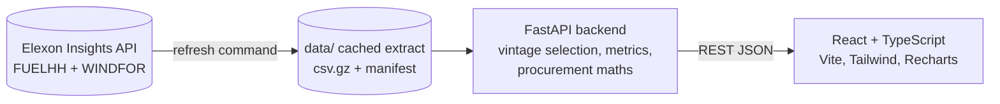

# WindSight - UK Wind Forecast Intelligence

A full-stack analytics MVP that helps a UK electricity procurement desk understand **which wind forecast was actually available at its day-ahead decision cutoff**, how reliable such forecasts have been, and how forecast error could flow into an illustrative residual-requirement calculation.

Built on national GB wind data from Elexon only: **FUELHH** (actual half-hourly outturn) and **WINDFOR** (hourly forecasts, every publication retained). January 2026 is the evaluation window.

> **Live demo:** <https://ws-7k3q9x.vercel.app> · **API health:** <https://windsight-api-9yd5.onrender.com/api/health> · API docs: <https://windsight-api-9yd5.onrender.com/docs>
> The backend runs on a free Render instance that sleeps when idle; the first request after a pause can take about a minute. Deployment steps: [docs/DEPLOYMENT.md](docs/DEPLOYMENT.md).

## Business problem

Wind output is weather-dependent, and the day-ahead purchase must be made with the forecast published *before* the decision cutoff - not with later, better information. The desk needs to (1) see that exact forecast and its publication timestamps, (2) compare it with what happened, (3) quantify typical error, bias and bad periods, and (4) understand what that uncertainty means for the residual power it may need to buy.

## Features

* **Overview** - decision context (delivery date, cutoff in UK local time, optional period), KPIs (forecast/actual mean, MAE, RMSE, MAPE, bias, publication time, pair count), generation profile chart with gaps shown honestly and an optional prior-days P10-P90 band, auto-generated insight text built only from computed values.
* **Forecast Explorer** - every WINDFOR publication that covers the delivery day, which are eligible at the cutoff, which hours each one supplies, per-publication hindsight MAE; later publications can be shown but are marked unusable.
* **Accuracy Analysis** - back-test of the cutoff rule over any date range: actual vs forecast, absolute error over time, signed-error histogram, MAE by hour, scatter with y = x line, metrics table with sample counts, per-day table.
* **Procurement implications** - clearly *illustrative* sensitivity: user-entered demand D, `R̂ = max(0, D − forecast)` vs `R = max(0, D − actual)` and the residual error. No prices, savings or trading advice.
* **Data & Methodology** - provenance, extraction timestamp, quality counters, formulas, limitations. Header shows API status, a "REAL ELEXON DATA · CACHED" badge (or an amber fixture badge) and data freshness.
* Every number is tagged **Measured / Forecast / Derived / Illustrative**.

### Headline results in the cached data (D-1 09:00 UK rule, 1-31 Jan 2026, n = 744 hourly pairs)

| MAE | RMSE | Bias (forecast − actual) | MAPE | Over-forecast hours |
| --- | --- | --- | --- | --- |
| 2,127 MW | 2,606 MW | +1,852 MW | 22.2 % | 84.8 % |

Best day by MAE: 19 Jan (684 MW). Worst: 28 Jan (5,329 MW, all over-forecast). These are computed by the app from the cached data; the large positive bias may partly reflect scope differences between WINDFOR and FUELHH and is **not** explained here (see [METHODOLOGY](docs/METHODOLOGY.md)).

## Architecture



Details: [docs/ARCHITECTURE.md](docs/ARCHITECTURE.md).

## Tech stack

React 19, TypeScript, Vite, Tailwind CSS 4, Recharts, lucide-react · Python 3.12 (3.10+ works), FastAPI, Pydantic v2, pandas, httpx, pytest · Docker + Docker Compose, nginx · Vercel (frontend) + Render blueprint (backend).

## Repository layout

```text
.
├── backend/                 FastAPI service
│   ├── app/
│   │   ├── main.py          app factory, CORS, lifespan data load
│   │   ├── api/routes.py    thin REST handlers
│   │   ├── core/            config (env), logging, error handling
│   │   ├── models/          raw Elexon models + API response models
│   │   ├── data/            Elexon client, normalisation, store, refresh CLI
│   │   ├── services/        vintage, metrics, procurement, analysis
│   │   └── utils/timeutil.py   UTC / Europe/London helpers
│   ├── tests/               58 pytest tests
│   ├── requirements*.txt
│   └── Dockerfile
├── frontend/
│   ├── src/{components,pages,hooks,services,types,utils}
│   ├── Dockerfile, nginx.conf.template, vercel.json
├── data/                    cached real Elexon extract + manifest
├── docs/                    ARCHITECTURE, DATA_DICTIONARY, METHODOLOGY, DEMO_SCRIPT, DEPLOYMENT
├── docker-compose.yml, render.yaml, .env.example, .github/workflows/ci.yml
```

## Data sources

* Actuals: <https://bmrs.elexon.co.uk/api-documentation/endpoint/datasets/FUELHH/stream>
* Forecasts: <https://bmrs.elexon.co.uk/api-documentation/endpoint/datasets/WINDFOR/stream>
* API actually called: `https://data.elexon.co.uk/bmrs/api/v1/datasets/{FUELHH|WINDFOR}/stream` (no key needed)

Schemas, units, publication cadence, duplicate/missing handling: [docs/DATA_DICTIONARY.md](docs/DATA_DICTIONARY.md). All values are **MW**; FUELHH is a 30-minute average, WINDFOR is hourly.

## Key logic

**Forecast vintage selection (no look-ahead).** For delivery interval *t* and cutoff *C*, eligible forecasts have `publishTime ≤ C`; the one with the greatest publish time is used: `f*(t,C) = f(t,p*)`, `p* = max{p ≤ C}`. Publication exactly at *C* is eligible; nothing after *C* is ever used; hours with no eligible forecast stay empty.

**Metrics** (error = forecast − actual, so **positive bias = over-forecast**): MAE = mean|e|, RMSE = √mean e², Bias = mean e, MAPE = 100·mean|e/y| over y ≠ 0 (zero actuals excluded and counted).

**Timezones.** UTC for storage and comparison; Europe/London for display and for defining a delivery day (DST-aware). User-facing cutoff controls are UK local time.

**Limitations & assumptions** - national wind only; hourly forecast vs half-hourly actual (only on-the-hour timestamps are paired); one month; procurement tool is illustrative. Full list in [METHODOLOGY](docs/METHODOLOGY.md#7-limitations-of-national-wind-only).

## Run it

### Docker (recommended)

```bash
docker compose up --build
# UI  http://localhost:8080      API docs  http://localhost:8000/docs
```

> Transparency: Docker is not installed on the machine this project was built on, so **the Dockerfiles and compose file were written but not executed there**. CI builds/tests the code natively; please run the command above once to confirm on your machine.

### Without Docker

Backend (Python 3.12 recommended; 3.10+ works):

```bash
cd backend
python -m venv .venv && source .venv/bin/activate      # Windows: .venv\Scripts\activate
pip install -r requirements-dev.txt
uvicorn app.main:app --reload --port 8000
```

Frontend (Node 20+):

```bash
cd frontend
npm ci
npm run dev        # http://localhost:5173, proxies /api to localhost:8000
```

### Refresh the data from Elexon

```bash
cd backend && python -m app.data.refresh      # rewrites ../data/* (+ manifest with extraction time & checksums)
```

### Tests and checks

```bash
cd backend  && python -m pytest -q
cd frontend && npm run typecheck && npm run lint && npm test && npm run build
```

## Environment variables

See [.env.example](.env.example). Backend: `CORS_ORIGINS`, `DATA_DIR`, `LOG_LEVEL`, `WINDOW_START/END`, `DEFAULT_CUTOFF_DAYS_BEFORE`, `DEFAULT_CUTOFF_LOCAL_TIME`, Elexon client settings. Frontend (build time): `VITE_API_BASE_URL`. No secrets are required.

## REST API (OpenAPI at `/docs`)

`GET /api/health` · `/api/metadata` · `/api/actuals?start&end` · `/api/forecasts?start&end&cutoff` · `/api/analysis/profile?date&cutoff[&period_from&period_to]` · `/api/analysis/vintages?date&cutoff` · `/api/analysis/accuracy?start&end&cutoff_days_before&cutoff_time` · `/api/analysis/procurement-sensitivity?date&demand_mw&cutoff`

Instants are ISO-8601 **with** an offset; errors share one envelope `{"error": {"code", "message"}}`. (`accuracy` takes a rolling cutoff rule instead of a single instant - explained in METHODOLOGY.)

## Deployment

Frontend → Vercel, backend → Render (Docker, `render.yaml`). Step-by-step and caveats (free-tier cold starts, CORS) in [docs/DEPLOYMENT.md](docs/DEPLOYMENT.md). Deployed: frontend on Vercel, backend on Render (URLs at the top of this README).

## AI-tool disclosure

This project was developed with substantial assistance from an AI coding assistant (**Claude Code**, Anthropic). The AI wrote and iterated on the code, tests and documentation; the author is responsible for reviewing, running and understanding the submission.

## Known limitations and next steps

* Cached, not live: new months need `python -m app.data.refresh` (a scheduled refresh would be the next step).
* Only hourly timestamps are evaluated; a 30-minute forecast product or an explicit hour-average convention for actuals would use all data.
* Persistent over-forecast bias should be investigated (dataset scope, curtailment) before drawing conclusions.
* Add demand, price and plant data, probabilistic forecasts and proper calibration to move from illustration to a trading recommendation.
* Code-split the chart bundle; add end-to-end browser tests.

Contains BMRS data © Elexon Limited, used under the Elexon open data licence.
