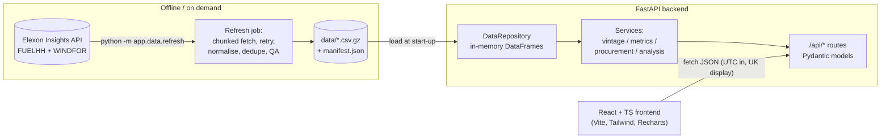
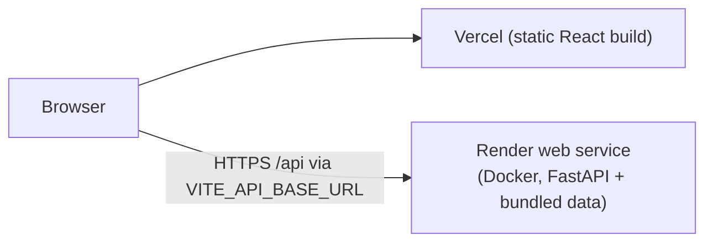

# Architecture

## Component responsibilities

| Component | Path | Responsibility |
| --- | --- | --- |
| Elexon client | `backend/app/data/elexon_client.py` | Separate `wind_actuals` (FUELHH) and `wind_forecasts` (WINDFOR) methods; 7-day windows; timeouts; retry with exponential back-off on 429/5xx/transport errors; clear `UpstreamError`s |
| Raw models | `backend/app/models/elexon.py` | Typed validation of raw rows; null/non-numeric `generation` -> `None` |
| Normaliser | `backend/app/data/normalize.py` | WIND filter, UTC parsing, deterministic dedupe, quality counters, post-checks |
| Refresh command | `backend/app/data/refresh.py` | Builds the cache + manifest (checksums, extraction time, window). Refuses to overwrite with empty results |
| Repository | `backend/app/data/store.py` | Loads the cache once, exposes bounded range queries |
| Vintage selection | `backend/app/services/vintage.py` | `publish <= cutoff`, latest per interval; single and rolling cutoffs |
| Metrics | `backend/app/services/metrics.py` | Alignment, MAE/RMSE/bias/MAPE, percentiles, grouping, histogram |
| Procurement | `backend/app/services/procurement.py` | Residual requirement maths |
| Orchestration | `backend/app/services/analysis.py` | Builds profile / accuracy / vintages / sensitivity responses |
| API | `backend/app/api/routes.py`, `app/models/api.py` | Thin handlers, parameter validation, typed responses, OpenAPI at `/docs` |
| Frontend | `frontend/src` | `services/api.ts` (only place that calls the backend), `hooks/` (data + decision context), `components/`, `pages/`, `utils/time.ts` (UK <-> UTC) |

## Request / data flow

1. The user sets delivery date, cutoff (UK local time) and optional period in the decision bar. `DecisionProvider` converts them to a UTC instant (`utils/time.ts`, DST-safe).
2. Each page calls the API through `useApi` (cancels stale requests, keeps previous data while refetching). The request key encodes every filter, so changing any filter re-queries the backend and recomputes derived numbers.
3. The route validates parameters (ISO instants must carry an offset; dates must be inside the configured window) and calls `services/analysis`.
4. The service slices the in-memory frames to the UK delivery day (23/24/25 h aware), applies vintage selection with the cutoff, aligns with actuals, and computes metrics.
5. The JSON response carries UTC timestamps, nulls for gaps, publication timestamps and provenance fields; the UI formats them as UK local time and tags every number as Measured / Forecast / Derived / Illustrative.

## Service boundaries

* The frontend never talks to Elexon. The backend never talks to Elexon **while serving requests**; only the refresh job does. This keeps the demo deterministic, fast and independent of external availability.
* Business logic is pure and tested without HTTP (`services/*`); routes are thin; the repository is injected (tests swap in a tiny in-memory fixture).

## Error handling

* `AppError` family -> `{ "error": { code, message } }` with proper status: `422 invalid_parameters / outside_data_window / invalid_period`, `503 data_unavailable`, `500 internal_error`.
* Validation errors are normalised to the same envelope (field + issue list). Unhandled exceptions are logged server-side (JSON logs) and returned as a generic 500, never a stack trace.
* If the cache is missing the API still starts; `/api/health` reports `degraded` and data endpoints return 503 with the exact fix. The UI shows this and **never substitutes other data**.
* Frontend: every data region has loading, error (with retry), empty and partial states; network failures are reported as "API unreachable".

## Caching strategy

* Historical Elexon data is immutable once settled, so it is cached as compressed CSV (≈100 kB for the month) with a manifest (extraction timestamp, window, per-file SHA-256, quality counters).
* The cache is committed to the repo so Docker, CI and the hosted demo are reproducible and offline-capable. `data_mode: elexon_cached` is surfaced in `/api/metadata` and as a status badge in the UI; a different mode would show an amber "DEMO / FIXTURE DATA" badge.
* No database: ~20k rows fit comfortably in memory; adding PostgreSQL would not materially improve the MVP.

## Deployment architecture

* Vercel hosts the static frontend. FastAPI runs as a container on a Python-capable host (Render blueprint included) rather than Vercel functions, because the service holds data in memory and uses pandas/numpy, which suits a long-lived process better than a serverless function.
* Locally / Docker Compose: nginx serves the build and proxies `/api` to the backend, so the browser uses a single origin.
* Production CORS is restricted to `CORS_ORIGINS`.

## Trade-offs

| Decision | Why | Cost |
| --- | --- | --- |
| Cache + refresh job instead of live proxying | Reliable demo, no rate-limit exposure, auditable data | Not live; must re-run the refresh for new data |
| In-memory pandas instead of a DB | Simplicity, tiny data | Would not scale to multi-year history |
| Exact-timestamp pairing | No fabricated values | Only hourly points are evaluated |
| Rolling cutoff rule for back-tests | Faithful replay of a daily decision | Differs from a single arbitrary cutoff; documented |
| Recharts | Fast to build, accessible enough | Large bundle (~200 kB gz); could be code-split |
